# AmarToken · Central University Residential Hall Dining & Meal Token System
**Mawlana Bhashani Science and Technology University (MBSTU), Santosh, Tangail-1902**

---

## 📌 Executive Summary

**AmarToken** is a centralized, digital meal reservation and residential hall dining management platform designed specifically for the residential halls of **Mawlana Bhashani Science and Technology University (MBSTU)**. The system transitions the university from legacy paper-based dining tokens and manual kitchen headcounts to a fully automated, transparent, and auditable digital ecosystem.

### Core Objectives
1. **Zero Food Wastage Policy**: Daily meal token booking operates strictly between **6:00 PM and 12:00 AM (Midnight)** for the following day's meals. Kitchen staff prepare the exact amount of food needed based on confirmed tokens.
2. **Non-Refundable Governance Standard**: Provost Council regulations mandate that all purchased tokens are final and non-refundable, eliminating last-minute cancellations that cause bulk perishable food loss.
3. **Gender-Segregated Residential Dining**: Halls are classified by gender (4 Male halls, 3 Female halls), with automated directory filtering and hall selection tailored to the boarder's academic profile.
4. **Subsidized Universal Pricing**: Fixed universal pricing of **৳30 for Lunch** and **৳30 for Dinner** (Day combo at **৳60**), ensuring equitable and nutritious dining for every registered boarder.
5. **Cryptographic Anti-Fraud Gate Verification**: Every token is accompanied by a unique, deterministically generated SVG QR code and cryptographic verification hash. The gate scanner enforces atomic single-use redemption, completely preventing duplicate entries and cross-hall dining fraud.
6. **Automated Kitchen Requisitioning**: Raw grocery requirements (rice, chicken/fish, lentils, cooking oil, spices, produce) are calculated dynamically from active token headcounts and can be exported as CSV for provost storekeeping.
7. **Digital Student Dining Wallet**: Boarders maintain an integrated dining wallet rechargeable through Mobile Financial Services (bKash, Nagad), Smart Campus Cards, or Hall Office cash deposits.
8. **Dual-Experience Architecture**: Clean, airy, minimalist SaaS-style landing page for unauthenticated visitors alongside a rich, authoritative institutional portal for authenticated boarders and hall administration with live booking countdown and moving notice board.

---

## 🏗️ Technology Stack & Architecture

AmarToken is built with modern web technologies focused on high performance, zero external runtime asset dependencies, and strict type safety:

| Layer | Technology | Version | Purpose & Implementation Details |
|---|---|---|---|
| **Runtime & Package Manager** | [Bun](https://bun.sh/) / Node.js | v1.4+ / v20+ | Lightning-fast dependency installation and build pipeline |
| **Frontend Framework** | [React](https://react.dev/) | 19.0.1 | Functional component architecture with modern hooks |
| **Language** | [TypeScript](https://www.typescriptlang.org/) | 7.0.2 | End-to-end typed domain models and strict null-checking |
| **Bundler & Dev Server** | [Vite](https://vite.dev/) | 8.3.8 | Instant HMR, ESM bundling, and optimized CSS chunking |
| **CSS & Design System** | [Tailwind CSS](https://tailwindcss.com/) | 4.3.5 | Custom university Crimson (`#8b1d24`), Amber, and Slate palette via `@tailwindcss/vite` |
| **Icons** | [Lucide React](https://lucide.dev/) | 0.546.0 | Cohesive, accessible SVG iconography |
| **Audio Synthesizer** | Web Audio API | Native Browser | Custom oscillator synthesis for scan beeps, errors, and purchase chimes (zero mp3 assets) |
| **Vector QR Code Engine** | Deterministic SVG Matrix | Custom Native | 21x21 and 25x25 matrix pattern generator with standard finder squares & barcode generator |
| **Visual Effects** | Canvas Confetti | 1.9.4 | Particle celebrations upon successful meal token purchases |

---

## 🏛️ MBSTU Residential Halls Directory (7 Halls)

AmarToken serves all seven residential halls of MBSTU, accommodating **8,500+ resident boarders**, categorized by residential gender:

| Code | Hall Name | Bangla Name | Gender | Capacity | Provost / Hall Manager | Contact Number |
|---|---|---|---|---|---|---|
| **JAMH** | Jananeta Abdul Mannan Hall | জননেতা আব্দুল মান্নান হল | **Male** | 1,250 | Prof. Dr. M. A. Matin | +880-1711-102938 |
| **SZRH** | Shahid Ziaur Rahman Hall | শহীদ জিয়াউর রহমান হল | **Male** | 1,400 | Prof. Dr. Tariqul Islam | +880-1712-445566 |
| **SAFH** | Shaheed Abrar Fahad Hall | শহীদ আবরার ফাহাদ হল | **Male** | 1,350 | Prof. Dr. Mahmudul Hasan | +880-1715-998877 |
| **SOHH** | Shaheed Osman Hadi Hall | শহীদ ওসমান হাদী হল | **Male** | 1,200 | Prof. Dr. Anwarul Karim | +880-1718-223344 |
| **AKBH** | Alema Khatun Bhashani Hall | আলেমা খাতুন ভাসানী হল | **Female** | 1,100 | Prof. Dr. Nasreen Begum | +880-1819-482019 |
| **SJJH** | Shahid Janoni Jahanara Imam Hall | শহীদ জননী জাহানারা ইমাম হল | **Female** | 1,150 | Prof. Dr. Ferdousi Begum | +880-1911-334455 |
| **BFZH** | Begum Fazilatunnessa Zoha Hall | বেগম ফজিলাতুন্নেছা জোহা হল | **Female** | 1,050 | Prof. Dr. Tahmina Akhter | +880-1817-667788 |

---

## 🍽️ Meal Slots, Rates & Strict Operating Schedule

The university dining system operates two primary daily meals at subsidized rates exclusively for registered resident students:

```
┌─────────────────────────────────────────────────────────────────────────────────┐
│                           DAILY DINING SCHEDULE                                 │
├───────────────┬───────────────────┬───────────────────┬───────────┬─────────────┤
│   MEAL SLOT   │  SERVING WINDOW   │  BOOKING WINDOW   │   PRICE   │   STATUS    │
├───────────────┼───────────────────┼───────────────────┼───────────┼─────────────┤
│   Lunch       │ 12:30 PM - 2:30 PM│6:00 PM - 12:00 AM │   ৳30.00  │Non-Refundable│
│   Dinner      │  7:30 PM - 9:30 PM│6:00 PM - 12:00 AM │   ৳30.00  │Non-Refundable│
│   Day Pass    │ Both Daily Slots  │2-Meal Combo Bundle│   ৳60.00  │Subsidized   │
└───────────────┴───────────────────┴───────────────────┴───────────┴─────────────┘
```

---

## 🖥️ Frontend Architecture & View Breakdown

The frontend is structured into modular components linked through the main state coordinator (`App.tsx`). The application is responsive across mobile, tablet, and desktop viewports.

```mermaid
flowchart TD
    App["App.tsx (Root State Coordinator & RBAC Guard)"]
    Header["Header.tsx (Role-Restricted Navbar & Profile Badge)"]
    Home["HomePage.tsx (SaaS Landing or Institutional Dashboard)"]
    Store["StudentPortal.tsx (Token Booking & 7-Hall Store - Students Only)"]
    Tokens["TokenVault.tsx & TokenCard.tsx (Passbook & QR Codes - Students Only)"]
    Scanner["StaffScanner.tsx (Gate Turnstile Verification - Staff & Admin)"]
    Kitchen["ManagerKitchenPanel.tsx (Customizable Requisition & Budget Calculator - Staff & Admin)"]
    AdminModal["AdminHallEditorModal.tsx (Hall Credentials & Rate Editor - Admin Only)"]
    Wallet["WalletModal.tsx (bKash/Nagad/Card Recharge)"]
    Profile["ProfileModal.tsx (Institutional Profile Record & Logout)"]
    Register["RegisterModal.tsx (RBAC Role Selector, ID Proof Upload & MBSTU SSO)"]

    App --> Header
    App --> Home
    App --> Store
    App --> Tokens
    App --> Scanner
    App --> Kitchen
    App --> AdminModal
    App --> Wallet
    App --> Profile
    App --> Register
```



---

### 1. Dual-Mode Header Navigation (`Header.tsx`)
The top bar implements an adaptive contract that adjusts between unauthenticated visitor browsing and authenticated student sessions:

- **Brand Wordmark & Emblem**:
  - Left zone features the official MBSTU university emblem.
  - Dual-line typography: **`AmarToken`** on the top line in deep crimson (`#8b1d24`) and **`MEAL MANAGEMENT`** in bold uppercase amber/crimson (`text-[10px] text-amber-600 font-bold tracking-wider`) below it.
- **Unauthenticated (Logged-Out) Mode**:
  - **Distraction-Free**: All internal app navigation links (`Home`, `Meal Store`, `My Tokens`, `Gate Scanner`, `Kitchen & Provost`) and mobile bottom tab bars are hidden.
  - **Right Actions**: Features a simple text link/button **`Log in`** and a solid primary crimson (`#8b1d24`) **`Get Started`** button that trigger the academic authentication modal in login or register mode.
- **Authenticated (Logged-In) Mode**:
  - **Desktop Navigation Links**: Direct navigation between `Home`, `Meal Store`, `My Tokens` (with live active token counter badge), `Gate Scanner`, and `Kitchen & Provost`.
  - **Student Profile Button**: Displays initials badge, boarder name, room number, and hall code; opens the Profile & Account Settings modal.
  - **Dining Wallet Balance**: Interactive crimson balance pill displaying current balance with a 1-click `+` recharge shortcut.
  - **Direct Logout Action**: One-click session termination returning the user to the unauthenticated landing view.
  - **Mobile Navigation Bar**: Fixed horizontal action strip providing one-touch tab switching on smaller screens.

---

### 2. Dual-Experience Homepage (`HomePage.tsx`)
`HomePage.tsx` dynamically switches between a modern, minimalist SaaS-style landing page for visitors and a full-featured institutional dashboard for logged-in boarders:

#### A. Unauthenticated Minimalist SaaS Landing Experience
When the user is **not logged in**, the landing page presents a focused, light-background SaaS interface matching the institutional crimson (`#8b1d24`), amber, and slate palette:

1. **Centered Hero Section**:
   - **Radial Backdrop Glow**: Subtle soft radial gradient glow at the top center in crimson/rose (`from-red-100/70 via-rose-50/40 to-transparent`).
   - **Top Pill Badge**: Rounded pill with subtle border and backdrop blur: `🍴 Smart Meal Management for MBSTU Halls`.
   - **Main Headline**: Large, bold, centered typography:
     - Line 1 in dark slate (`#0f172a`): `"The most efficient way to"`
     - Line 2 in a rich gradient from MBSTU crimson (`#8b1d24`) through red-700 to warm amber (`to-amber-500`): `"manage hall meals."`
   - **Subtitle**: Centered muted slate paragraph: *"Automate student bookings, manage prices, track billing, and streamline hall operations with our comprehensive solution tailored for MBSTU."*
   - **Primary CTA Button**: Centered rounded-xl button in primary crimson (`#8b1d24`) with subtle shadow: `"Get Started Now"` and a `ChevronRight` icon.
2. **3-Column Feature Cards Section**:
   - Responsive grid (`grid-cols-1 md:grid-cols-3 gap-8 max-w-6xl mx-auto`) of clean white cards (`bg-white rounded-3xl p-8 border border-slate-100 shadow-sm hover:shadow-md transition-all`):
   - **Smart Bookings**: `Clock` icon inside a crimson (`#8b1d24`) rounded-2xl square badge. Explains booking within daily cutoff windows across all 7 MBSTU halls.
   - **Prepaid Wallet**: `CreditCard` icon inside an amber/gold rounded-2xl square badge. Highlights automated balance tracking via bKash, Nagad, and Smart Campus ID.
   - **Hall Admin Tools**: `ShieldCheck` icon inside a dark slate rounded-2xl square badge. Outlines gate QR verification, payment deposits, and kitchen grocery requisitions.
3. **Minimalist Institutional Footer**:
   - Clean border-top footer (`border-t border-slate-200/80 pt-8 pb-4 mt-20 sm:mt-28`):
   - Left side: Grayscale MBSTU emblem, bold `"AmarToken"`, and `"Hall Management System"` subtitle.
   - Right side: `"Mawlana Bhashani Science and Technology University"` and `"© 2026 All rights reserved. Developed for MBSTU."`

#### B. Authenticated Institutional Hall Dashboard
When the user **is logged in**, `HomePage.tsx` renders the full institutional management portal:
- **Session Bar with Public Preview Toggle**: Displays active boarder credentials and provides a one-click toggle (`Preview Public Landing Page →`) so administrators and boarders can inspect the visitor landing page without logging out.
- **Institutional Hotline & Live Booking Window Countdown Strip**:
  - Displays the active daily meal booking window (**6:00 PM – 12:00 AM Midnight** for the following day) and dining hotline (`+880-921-55100`).
  - **Live Clock & Real-Time Booking Pill**: Displays local time and dynamic status (`● Booking Window Open` or `○ Booking Window Closed`) with a live ticking countdown (`Closes in Xh Ym Zs` / `Opens in Xh Ym Zs`).
- **Hero Section**: Showcases the institutional mission, subsidized rates (৳30 Lunch / ৳30 Dinner), and quick action buttons to enter the meal store, view existing tokens, or jump to the hall directory.
- **Live Metrics Counter**: Displays real-time campus scale: 7 residential halls, 8,500+ boarders, 4,800+ daily meals served, and 100% digital QR verification.
- **Official Notice Board & Circulars (Moving Marquee Ticker)**:
  - Smooth continuous horizontal right-to-left marquee ticker (`animate-marquee`) of administrative directives and circulars.
  - Hovering pauses the marquee track for effortless reading.
  - Category filter pills above (`All Notices`, `Dining & Cutoffs`, `Regulations`, `Administration`).
  - Clicking any moving card opens the official circular modal with provost council details.
- **Residential Halls Directory (Gender-Filtered with Micro-Interactions)**:
  - Dynamically classifies the 7 halls by gender (Male halls: JAMH, SZRH, SAFH, SOHH; Female halls: AKBH, SJJH, BFZH).
  - Automatically filters the directory according to the logged-in student's gender, with interactive filter pills to toggle between `My Halls`, `Male Halls (4)`, `Female Halls (3)`, or `All Halls (7)`.
  - Cards feature smooth hover lift (`hover:-translate-y-1 hover:shadow-lg`).
  - Shows hall code, gender classification, capacity, boarder count, provost name, and fixed rate (`Lunch (৳30) & Dinner (৳30)`).
  - **Interactive Click-to-Copy Provost Phone**: One-touch clipboard copying with temporary `"Copied!"` indicator and audio feedback.
  - Cleaned-up card layout with "Today's Lunch" preview snippet removed.
- **Dining Regulations & Timings Table**: Formal breakdown of dining windows (Lunch: 12:30 PM – 2:30 PM; Dinner: 7:30 PM – 9:30 PM), midnight booking deadline (12:00 AM Midnight, opens 6:00 PM), universal subsidized pricing (৳30.00 each), non-refundable status, and decorum rules.
- **Provost Council Message**: Official message from Prof. Dr. Mahmudul Hasan, Chairman of Provost Council, repositioned directly above the emergency directory, explaining dining discipline, ৳30 subsidized meals, and zero food waste.
- **Emergency Directory**: Contact channels for the Provost Council, Proctor Office, University Medical Center, and ICT Helpdesk.

---

### 3. Student Meal Store (`StudentPortal.tsx`)
The central transaction portal where students purchase meal tokens:
- **Boarder Identity Pill**: Shows student name, verified academic email, hall room, and current dining balance.
- **Gender-Filtered Hall Switcher**: Tabbed selector dynamically filtered by the boarder's gender, preventing booking across unauthorized gender residences or halls outside their allocation.
- **Full-Day Dining Pass Banner (Combo Bundle)**:
  - Provides a 1-click purchase for both **Lunch (৳30)** and **Dinner (৳30)** at **৳60** for the daily combo pass.
- **Daily Meal Cards (Lunch & Dinner)**:
  - Fixed subsidized price of **৳30.00** per meal token.
  - Highlights serving windows, daily cutoff time (12:00 AM Midnight), caloric content, and menu descriptions.
  - Clear alerts reinforcing the strict non-refundable token policy.
- **Purchase Modal (`handleOpenPurchase`)**:
  - **Dietary Preference Selection**: Choose between *Halal Non-Veg (Standard)*, *Regular*, *Vegetarian*, or *Diabetic / Low-Oil*.
  - **Payment Channel Selector**: Select *Hall Wallet*, *bKash MFS Direct*, or *Smart Campus ID*.
  - **Client-Side Validations**: Verifies that the boarder belongs to the hall, ensures sufficient wallet balance, and generates a unique token serial upon confirmation.
  - **Interactive Celebrations**: Plays an authentic 4-note ascending chord synthesized via Web Audio API and fires particle confetti.

---

### 4. Digital Token Passbook & QR Vault (`TokenVault.tsx` & `TokenCard.tsx`)
Boarders store, view, and present their purchased meal tokens:
- **Token Ticket Card**:
  - Rendered with a crimson header strip, hall name, and status badge (`ACTIVE`, `REDEEMED`, `EXPIRED`).
  - **Crisp SVG QR Code**: 21x21 matrix pattern deterministically generated from the token's cryptographic verification hash. Can be scanned directly from phone screens or printed paper.
  - **Barcode Strip**: Visual barcode rendering with truncated SHA-256 hash representation.
  - Full metadata: Token number (e.g. `SAFH-20261112-L-084`), meal slot, date, menu title, student name, room number, and dietary selection.
- **Anti-Fraud Badging**: Distinct badges for active valid tokens vs. redeemed tokens (displaying exact redemption timestamp and gate attendant name).
- **Interactive Simulator**: Features a "Test Gate Scan" button on active tokens that immediately routes to the Gate Scanner and simulates gate turnstile entry.
- **Filtering & Search**: Live filter tabs (`All`, `Active Tokens`, `Redeemed`) with real-time search across token number, meal slot, menu name, and date.
- **Hardcopy Printing**: Supports `window.print()` for students needing printed meal slips.

---

### 5. Gate Verification Terminal (`StaffScanner.tsx`)
A dedicated terminal interface for dining hall gate attendants and university security staff:
- **Simulated Optical Scanner**:
  - Dark-mode viewfinder with corner brackets and an animated red laser scanning beam.
  - Real-time visual and audio feedback:
    - 🟢 **Meal Approved**: High-frequency dual-tone chime (A5 880Hz to E6 1320Hz), admitting student with name, room, and meal type.
    - 🔴 **Fraud Alert (Double-Spend)**: Low-frequency sawtooth buzz (180Hz to 140Hz), displaying exact prior redemption timestamp.
    - 🟡 **Wrong Hall / Unrecognized**: Alerts gate staff if a boarder from another hall attempts access.
- **Manual Input Console**: Accepts typed or pasted token numbers for barcodes that cannot be read optically.
- **Shift Statistics Counter**: Tracks live admissions vs. blocked/fraud attempts for the current shift.
- **Shift Gate Verification Log**: Rolling 20-event log showing timestamp, student name, token serial, and admission verdict.
- **One-Click Test Scenarios**: Built-in test buttons to immediately simulate:
  - Valid Lunch token scan
  - Double-spend fraud attempt
  - Cross-hall unauthorized scan (e.g., AKBH token at SAFH gate)

---

### 6. Customizable Kitchen Grocery & Meal Cost Calculator (`ManagerKitchenPanel.tsx`)
An essential operational and budgeting tool for kitchen head chefs, mess committees, and hall administration:
- **Headcount Scaling**: Interactive scaler bar with numeric input and quick presets (150, 300, 500, 800 portions).
- **4-Card Financial Overview Dashboard**:
  1. **Total Estimated Meal Cost**: Real-time sum of all grocery requisitions.
  2. **Target Headcount**: Active meal count breakdown with lunch and dinner token tallies.
  3. **Actual Cost Per Plate**: Exact calculated preparation cost per meal plate.
  4. **Hall Token Revenue vs. Budget Balance**: Displays whether current meal costs yield a **Surplus** (emerald) or require a **University / Hall Subsidy** (crimson).
- **Role-Differentiated Capabilities**:
  - **Hall Admin (Full Edit Mode)**: Inline editing for item names, categories, per-student gram/ml quotas, direct total quantities with bidirectional synchronization, unit pickers, unit prices, row deletion, "+ Add Ingredient" row generator, and "Reset to Default Standard" button.
  - **Hall Staff (Scaler Mode)**: Read-only requisition table with active headcount scaling, real-time calculations, and CSV export.
- **Persistent Storage**: Customized ingredients and prices are saved per hall in `localStorage` (`amartoken_kitchen_items_[hallId]`).
- **One-Click CSV Export**: Downloads a formatted requisition file (`[HALL]_Kitchen_Budget_[HEADCOUNT]_Portions.csv`) for market procurement and audit records.

---

### 7. Student Dining Wallet (`WalletModal.tsx`)
An integrated financial ledger for dining subsidies and token purchases:
- **Available Balance Banner**: Displays active dining balance in Bangladeshi Taka (৳).
- **Quick Top-Up Increments**: Preset buttons for ৳100, ৳300, ৳500, ৳1,000, or custom amount input.
- **Multi-Channel Recharge**:
  - **bKash**: Personal / Merchant Mobile Financial Service
  - **Nagad**: Bangladesh Post Office MFS
  - **Smart Campus ID**: MBSTU RFID student debit card
  - **Hall Office Cash**: Offline cash deposit slip validated by the hall accountant
- **Audit Transaction Ledger**: Itemized list of credits (top-ups) and debits (token purchases) with timestamps and transaction reference IDs.

---

### 8. Institutional Profile & RBAC Identity (`ProfileModal.tsx`)
Manages boarder and staff registration details, institutional credentials, and access levels:
- **Role Badge & Identification**: Displays role badge (`STUDENT`, `STAFF`, `ADMIN`) with university emblem or verified official employee ID card photo.
- **Data Integrity Protection**: Institutional email and Student/Staff IDs are permanently locked to prevent impersonation or transfer of subsidized boarder rights.
- **Role-Adaptive Fields**: Displays academic credentials for students and administrative designations for staff/admin.
- **Session Management**: Secure logout flow with confirmation prompt, redirecting users to the unauthenticated minimalist landing page.

---

### 9. Role-Based Authentication & Registration (`RegisterModal.tsx`)
Enforces authentic university affiliation and role-specific enrollment:
- **3-Tab Segmented Role Selector**: Select between **Student**, **Hall Staff**, and **Hall Admin** in both Sign-In and Registration modes.
- **Strict MBSTU Domain Enforcement**: Exclusively permits verified institutional emails (`@mbstu.ac.bd`) and rejects all third-party domains.
- **Bug-Free Email Autofill**: Clicking recent email suggestion chips strictly populates only the email input, clearing passwords so users must enter credentials manually.
- **Quick Demo Fill**: Dedicated demo chips for instant credential testing (`tanvir.it22084@mbstu.ac.bd`, `staff.szrh@mbstu.ac.bd`, `admin.szrh@mbstu.ac.bd`).
- **Role-Specific Registration Flows**:
  - **Students**: Collects Student Name, ID/Roll, Gender, Assigned Residential Hall (gender filtered), Room #, and Department.
  - **Hall Staff & Admin**: Streamlined form requiring Name, Institutional Email, Password, Gender, Assigned Hall, Contact Phone, and mandatory **Official ID Card Proof Upload** with instant image preview thumbnail.
- **Account Persistence**: Automatically synchronizes registered accounts and seeded demo credentials in `localStorage`.

---

### 10. Admin Hall Credentials & Rates Editor (`AdminHallEditorModal.tsx`)
Dedicated administrative interface accessible to Hall Admins:
- **Hall Details Management**: Allows modifying hall official name, short code, and seat capacity.
- **Provost & Dining Office Directory**: Configure Provost Full Name, Academic Designation, Hall Office Phone, and Support Email.
- **Dining Management Contacts**: Update Dining Manager Name and Emergency Contact Phone.
- **Meal Rate Governance**: Modify Lunch Rate (৳) and Dinner Rate (৳), instantly updating meal schedules, checkout totals, and combo pass pricing across the portal.
- **Provost Desk Notice**: Update official statements and policies broadcast to resident boarders on the homepage.
- **Real-Time Synchronization**: Changes save to `localStorage` and trigger instant global state updates with audio chimes and confirmation toasts.

---

## 🔊 Native Audio Synthesizer (`soundEffects.ts`)

To ensure 100% offline reliability without broken external audio files or latency, AmarToken implements a zero-asset audio synthesizer utilizing the native browser **Web Audio API**:

- **Success Scan Chime (`playSuccessScan`)**: Sine wave oscillator ramping from A5 (880 Hz) to E6 (1320 Hz) over 180ms with exponential gain decay.
- **Error / Fraud Buzz (`playErrorBuzz`)**: Sawtooth wave oscillator shifting from 180 Hz down to 140 Hz over 280ms, delivering immediate audible feedback to gate staff.
- **Purchase Celebration Chime (`playPurchaseChime`)**: 4-note ascending chord (C5 523.25 Hz, E5 659.25 Hz, G5 783.99 Hz, C6 1046.5 Hz) using triangle wave synthesis.
- **Tab Interaction (`playTabSwitch`)**: Subtle 440 Hz sine blip for clean tactile UI navigation.

---

## 🔲 Deterministic SVG QR & Barcode Generator (`qrGenerator.ts`)

Tokens generate verifiable 2D matrix patterns without external network calls or heavy npm libraries:
- **Cryptographic Bit Hash**: The verification string is hashed through a 32-bit FNV-1a pseudo-random expansion algorithm into a 64-byte deterministic sequence.
- **Finder Patterns**: Standard 7x7 concentric position-detection squares placed at top-left, top-right, and bottom-left coordinates.
- **Timing Alignment Patterns**: Alternating bit strips along Row 6 and Column 6.
- **Data Matrix**: Bitwise data distribution rendering sharp vector `<rect>` elements styled with university crimson `#8b1d24`.
- **Barcode Synthesizer**: Generates Code-128 styled start/stop guard bars and variable-width stripes derived from the token serial.

---

## 📂 Source Code & Directory Layout

```
AmarToken/
├── README.md                    # Comprehensive technical documentation & system manual
├── index.html                   # HTML entry point with Plus Jakarta Sans & JetBrains Mono fonts
├── metadata.json                # Project description and capability metadata
├── package.json                 # Project dependencies, scripts, and engine specifications
├── tsconfig.json                # Strict TypeScript configuration
├── vite.config.ts               # Vite bundler configuration with Tailwind CSS v4 plugin
├── public/                      # Static assets and university emblems
│   └── assets/aistudio/         # Official university project crests
└── src/
    ├── App.tsx                  # Root component & central authentication state coordinator
    ├── main.tsx                 # React DOM mount point
    ├── index.css                # Tailwind CSS v4 theme variables and typography
    ├── types/
    │   └── index.ts             # Domain models (Tokens, Halls, Students, Transactions, Kitchen)
    ├── data/
    │   └── hallsData.ts         # Data seeds for all 7 MBSTU halls, schedules & demo student
    ├── utils/
    │   ├── qrGenerator.ts       # Deterministic SVG QR matrix & barcode generator
    │   └── soundEffects.ts      # Browser Web Audio API synthesizer
    └── components/
        ├── Header.tsx           # Adaptive navbar (minimalist visitor view vs full boarder nav)
        ├── HomePage.tsx         # Dual-mode view: minimalist SaaS landing or institutional dashboard
        ├── StudentPortal.tsx    # Hall meal store, cutoff enforcement & combo pass
        ├── TokenVault.tsx       # Digital token passbook, filters & print layout
        ├── TokenCard.tsx        # Printable token ticket with SVG QR code & barcode
        ├── StaffScanner.tsx     # Gate turnstile verification terminal with laser animation
        ├── ManagerKitchenPanel.tsx # Kitchen headcount & raw grocery requisition engine
        ├── WalletModal.tsx      # Student dining wallet deposit & transaction history
        ├── ProfileModal.tsx     # Institutional profile inspector & editor
        ├── AdminHallEditorModal.tsx # Hall credentials, provost details & meal rate governance
        └── RegisterModal.tsx    # RBAC role selector, email SSO & ID proof upload
```

---

## 🛠️ How to Run & Build

### Prerequisites
- [Bun](https://bun.sh/) (v1.2+) **or** [Node.js](https://nodejs.org/) (v20+ / v22+)

### 1. Install Dependencies
```bash
# Using Bun (Recommended)
bun install

# Or using npm
npm install
```

### 2. Start the Development Server
```bash
# Using Bun
bun run dev

# Or using npm
npm run dev
```
The application will launch immediately at **`http://localhost:3000`**.

### 3. Verify TypeScript Types
```bash
bun run lint
# or: npx tsc --noEmit
```

### 4. Build for Production
```bash
bun run build
# or: npm run build
```
Generates an optimized client bundle in the `dist/` directory ready for deployment on Cloud Run, Vercel, Netlify, or any static hosting service.

---

## 📋 Comprehensive Domain Model (TypeScript)

```typescript
export type MealSlot = 'LUNCH' | 'DINNER';

export type DietaryType = 'REGULAR' | 'VEGETARIAN' | 'HALAL_NON_VEG' | 'DIABETIC_SPECIAL';

export type TokenStatus = 'ACTIVE' | 'REDEEMED' | 'EXPIRED';

export interface MenuItem {
  id: string;
  name: string;
  description: string;
  calories: number;
  dietary: DietaryType[];
  itemsList: string[];
}

export interface MealSchedule {
  id: string;
  mealSlot: MealSlot;
  title: string;
  timeWindow: string;
  cutoffTime: string; // e.g. "10:30 AM"
  cutoffHoursRemaining: number;
  price: number;
  isCutoffPassed: boolean;
  menu: MenuItem;
}

export interface ResidentialHall {
  id: string;
  name: string;
  code: string;
  banglaName?: string;
  capacity: number;
  currentResidents: number;
  managerName: string;
  phone: string;
  colorTheme: string;
  diningSchedule: MealSchedule[];
}

export interface StudentProfile {
  id: string;
  studentId: string;
  name: string;
  academicEmail: string;
  password?: string;
  gender?: 'Male' | 'Female' | 'Other';
  hallId: string;
  hallName: string;
  roomNumber: string;
  department: string;
  batch: string;
  walletBalance: number;
  dietaryPreference: DietaryType;
  phone: string;
}

export interface MealToken {
  id: string;
  tokenNumber: string; // e.g. SAFH-20261112-L-084
  studentId: string;
  studentName: string;
  academicEmail?: string;
  hallId: string;
  hallName: string;
  roomNumber: string;
  mealSlot: MealSlot;
  mealDate: string; // YYYY-MM-DD
  menuName: string;
  dietaryType: DietaryType;
  price: number;
  status: TokenStatus;
  issuedAt: string;
  redeemedAt?: string;
  redemptionStaff?: string;
  verificationHash: string;
}

export interface WalletTransaction {
  id: string;
  date: string;
  type: 'TOPUP' | 'TOKEN_PURCHASE';
  amount: number;
  description: string;
  referenceId?: string;
  paymentMethod: 'BKASH' | 'NAGAD' | 'STUDENT_WALLET' | 'BANK_CARD' | 'HALL_OFFICE_CASH';
}

export interface KitchenRequisition {
  item: string;
  category: 'Grains' | 'Meat & Fish' | 'Vegetables' | 'Spices & Oil' | 'Dairy';
  quantity: number;
  unit: string;
  allocatedFor: string;
}
```

---

## 🔒 Security & Policy Guarantees

1. **Anti-Double-Spend Guarantee**: Once a token is scanned and marked `REDEEMED`, subsequent scan attempts at the gate trigger a distinct `FRAUD ALERT` with timestamp logging, locking out duplicate admissions.
2. **Cross-Hall Access Restriction**: Tokens are cryptographically tied to a specific hall ID. Scanners reject tokens from foreign halls with a `WRONG_HALL` denial.
3. **Academic Identity Verification**: Registration enforces `.ac.bd` / `.edu.bd` academic domains, ensuring university subsidies benefit only enrolled boarders.
4. **Offline Resiliency**: Client-side SVG QR rendering and Web Audio API synthesis ensure uninterrupted gate verification even during internet connectivity disruptions.

---

*AmarToken is maintained for the Mawlana Bhashani Science and Technology University Residential Hall Directorate & Dining Committee.*
